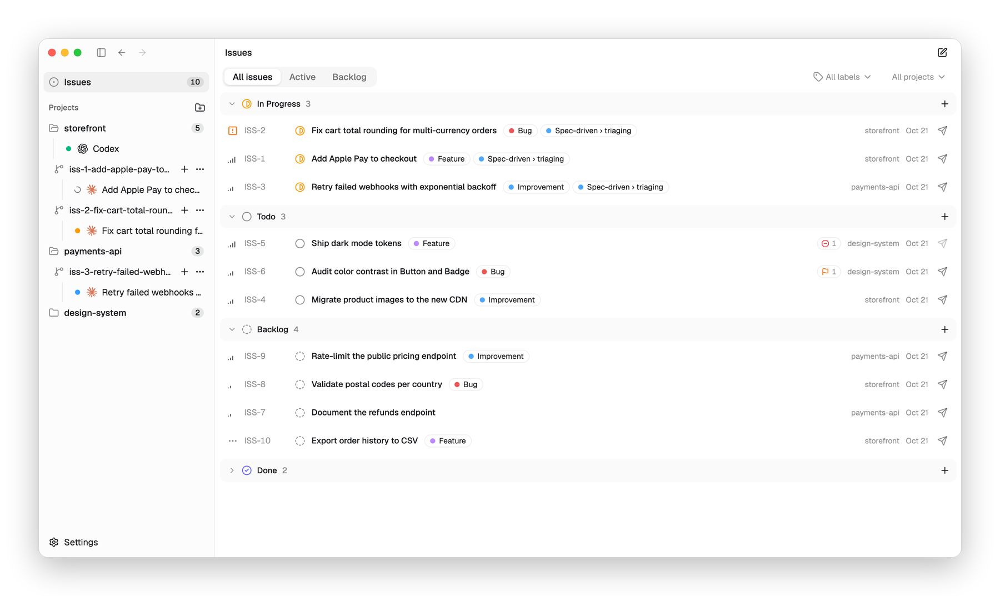

<div align="center">
  
  <h1>Hoot</h1>
  <p><strong>Run coding agents side by side, with issues and Git worktrees built in.</strong></p>
  <p>
    <a href="https://github.com/Levix0501/hoot/releases"></a>
    <a href="https://github.com/Levix0501/hoot/actions/workflows/release.yml"></a>
    <a href="LICENSE"></a>
  </p>
  <p>
    <a href="#download">Download</a> ·
    <a href="#getting-started">Getting started</a> ·
    <a href="CONTRIBUTING.md">Contributing</a> ·
    <a href="CHANGELOG.md">Changelog</a>
  </p>
</div>

<picture>
  <source media="(prefers-color-scheme: dark)" srcset=".github/assets/screenshot-dark.png">
  
</picture>

Hoot is a desktop app for developers who work with coding agents such as Claude Code, Codex and
OpenCode. Run as many agent sessions as you like in one window, keep track of the work as
Linear-style issues, and hand an issue to an agent in a Git worktree of its own with one click.

> [!NOTE]
> Hoot is in early alpha: expect rough edges and changes between versions. Windows support is a
> preview.

## Features

- **Every agent in one window.** Claude Code, Codex, OpenCode and your shell run in embedded
  terminals, as many sessions at a time as you like. Sessions you are not looking at keep running.
- **See which agent needs you.** A light beside each Claude Code session tells you whether it is
  working, waiting for your answer, stopped by an error, or done.
- **Issues, Linear-style.** Note what to do as local issues with statuses, priorities, labels,
  sub-issues and dependencies, and work through them from the keyboard.
- **From issue to agent in one click.** Start an issue, and Hoot creates a worktree for it and hands
  it to Claude Code, which takes it through a built-in spec-driven workflow: triage, then design.
- **A worktree for every task.** Agents work in parallel, each on a branch and in a folder of its
  own. Before deleting a worktree, Hoot checks it for work that would be lost.
- **Agents, managed.** Detect, install and update agents, and set each one's model, reasoning
  effort and extra arguments.
- **`hoot` for agents.** In every session, agents can read and update the project's issues with
  `hoot`, a command modeled on `gh issue`.

## Download

Download the latest version from [Releases](https://github.com/Levix0501/hoot/releases).

| Platform                   | File                       |
| -------------------------- | -------------------------- |
| macOS 13+, Apple silicon   | `Hoot-<version>-arm64.dmg` |
| macOS 13+, Intel           | `Hoot-<version>-x64.dmg`   |
| Windows 10+, x64 (preview) | `Hoot-Setup-<version>.exe` |

- **macOS**: open the DMG and drag Hoot to Applications. Hoot is signed and notarized.
- **Windows**: the installer sets Hoot up for your account only, without asking for administrator
  rights. It is not signed yet, so Microsoft Defender SmartScreen may warn you: click
  **More info**, then **Run anyway**. Windows blocks it while Smart App Control is on. For Git
  repositories, Hoot needs Git on `PATH`, where Git for Windows puts it.

Hoot updates itself: when a new version is out, an **Update** button appears next to **Settings**
at the bottom of the sidebar. To build Hoot from source, see [CONTRIBUTING.md](CONTRIBUTING.md).

## Getting started

1. **Add a project.** Click the button next to **Projects** in the sidebar, or choose
   **File › Add Project…** (⌘O), and pick a folder. A folder inside a Git repository adds the whole
   repository.
2. **Start a session.** Point at the project, click `+` and pick an agent or your shell. An agent
   that is not installed yet can be installed from **Settings › Agents** with npm.
3. **Note the work as issues.** Click **Issues** at the top of the sidebar, then **New issue** (or
   press C).
4. **Hand an issue to an agent.** Click the paper plane at the end of an issue's row: Hoot creates a
   worktree for the issue and starts Claude Code in it with the issue.

On macOS, ⌘1 to ⌘9 switch between sessions, and ⌘[ and ⌘] go back and forward between pages.

## YOLO mode

> [!WARNING]
> YOLO mode is on by default: every new session starts its agent with the option that lets it act
> without asking for approval (`--dangerously-skip-permissions` for Claude Code,
> `--dangerously-bypass-approvals-and-sandbox` for Codex and `--auto` for OpenCode). Turn it off in
> **Settings › Agents** to have each agent follow its own permission settings.

## The `hoot` command

Every session Hoot starts can run `hoot`, which reads and changes the issues of the session's
project. Agents use it to report their progress on an issue, and you can use it in any shell
session:

```sh
hoot issue list                                   # open issues of this project
hoot issue view ISS-12
hoot issue create --title "Fix the login bug" --priority high
hoot issue edit ISS-12 --add-label bug
hoot session start ISS-14                         # hand ISS-14 to Claude Code
```

Run `hoot --help` for every command and option.

## Privacy

- Your projects, issues and settings stay on your computer, in
  `~/Library/Application Support/Hoot` on macOS and `%APPDATA%\Hoot` on Windows. Worktrees go in
  `~/.hoot/worktrees`.
- Hoot collects no telemetry. It goes online to look for new versions, of itself on GitHub and of
  your agents on the npm registry, and to download the updates and agents you ask for.
- Hoot leaves your agents' configuration files alone: it passes its settings to each session on
  the command line. For an issue, it writes the issue to `.hoot/tmp` in the issue's worktree, which
  Git ignores.

## Contributing

Bug reports, ideas and pull requests are welcome: [open an issue](https://github.com/Levix0501/hoot/issues)
to report a bug or suggest a change. [CONTRIBUTING.md](CONTRIBUTING.md) explains how to build Hoot,
run its checks and send a change. Please report security vulnerabilities privately, as
[SECURITY.md](SECURITY.md) describes.

## License

Hoot is released under the [MIT License](LICENSE). The marks of Claude Code, Codex and OpenCode in
`src/renderer/assets/brand-icons` belong to Anthropic, OpenAI and the OpenCode authors, and are not
covered by this license.
